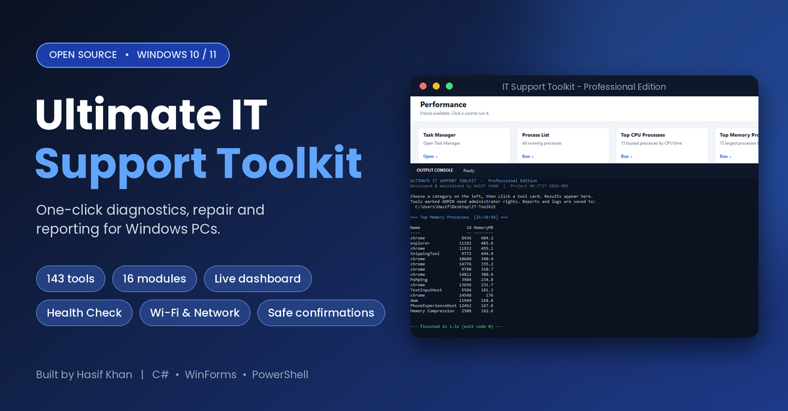
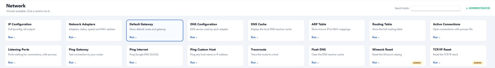
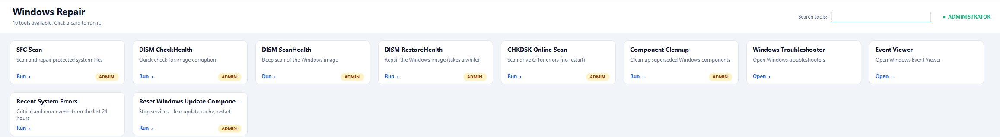
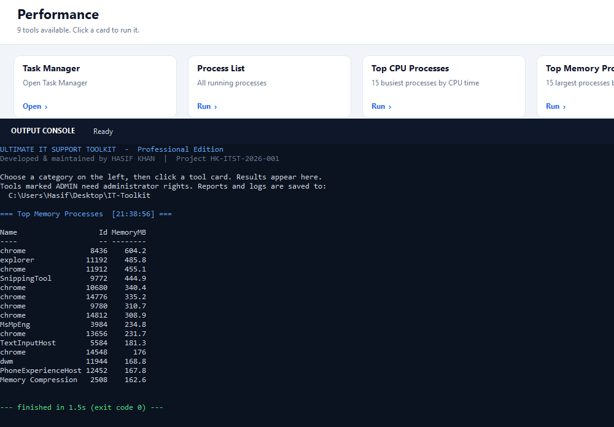

<div align="center">



# Ultimate IT Support Toolkit

**One-click diagnostics, repair and reporting for Windows PCs.**
A modern dashboard-style desktop app for IT support engineers, help-desk teams and power users.


</div>

---

## Overview

Ultimate IT Support Toolkit started as a batch-file menu and is now a single portable `.exe` with a clean, professional interface. It wraps 140+ everyday support tasks (system info, networking, repair, security, reports) behind simple tool cards, with results streamed into a built-in console.

No installer. No dependencies. Uses only what already ships with Windows.

## Features

- **Live dashboard**: CPU, memory, system-drive usage and uptime, plus a system overview.
- **Quick IT Health Check**: one click scans system, performance, storage, network, security and devices, with color-coded `OK / WARN / FAIL` results and a summary.
- **143 tools in 16 modules**: PC Information, Hardware, Network, Internet, Windows Repair, Disk & Storage, Performance, Services, Users & Accounts, Drivers & Devices, Windows Update, Security, Wi-Fi, Reports, System Tools, Power.
- **Search** across every tool instantly.
- **Output console**: live streaming output, Stop button for long tasks, Copy and Save.
- **Safe by design**: `ADMIN` badges, confirmation prompts for risky actions (firewall off, resets, shutdown) and validated input.
- **Reports and logs**: text reports and an activity log saved to `Desktop\IT-Toolkit`.

## Screenshots

**Network tools**


**Windows repair**


**Live output console**


## Quick start

### Download
Grab `IT-Support-Toolkit.exe` from the [Releases](../../releases) page and run it. For repair and reset tools, click **Run as Administrator** in the top-right corner.

### Build from source
Requires Windows 10/11. No SDK needed, because the compiler is built into Windows.

```bat
cd src
BUILD.bat
```

This produces `IT-Support-Toolkit.exe` next to the source. A GitHub Actions workflow also builds it on every push and attaches the exe to tagged releases (`v*`).

## Project structure

```
src/
  ToolkitApp.cs     Application source (UI, tool catalog, process runner)
  app.manifest      DPI awareness and visual styles
  app.ico           Application icon
  BUILD.bat         One-click build using the built-in C# compiler
docs/               Banner and screenshots
```

## Adding your own tool

Tools are declared in the `Catalog` class in `ToolkitApp.cs`:

```csharp
P("Network", "Ping Custom Host", "Ping any host name or IP", "ping -n 4 {0}")
    .Input("Enter host name or IP address:", "8.8.8.8");
```

`P` runs PowerShell, `C` runs cmd.exe and `L` launches an application. Chain `.NeedAdmin()`, `.Ask("confirmation text")` or `.Input(...)` as needed.

## Disclaimer

Some tools change system settings (firewall, network stack, Windows Update components, power actions). Use them only on computers you own or are authorized to administer. Provided as-is, without warranty.

## Author

**Hasif Khan**: developed and maintained. Contributions and issues are welcome.

## License

Released under the [MIT License](LICENSE).
